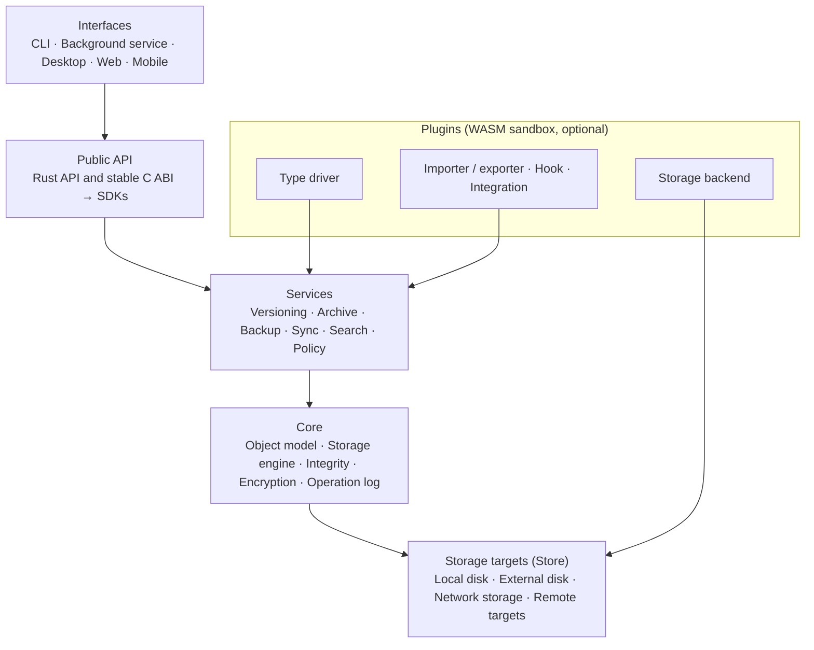

> **Türkçe:** [VISION.tr.md](VISION.tr.md)

# Apeiron — Product Vision and Requirements

> **Status:** This document describes the intended product; most capabilities mentioned here are not written yet (Planned). [ROADMAP.md](ROADMAP.md) shows what is done.

## Summary

Apeiron is a general-purpose, cross-platform data management engine that unifies version control, archiving, backup, synchronisation and integrity checking in a single core. Source code is only one of the supported data types. The same core manages a developer's repository, a musician's project and an institution's archive.

Apeiron is used in three ways: directly through the CLI and other interfaces, as a library inside other applications, or remotely as a background service. It scales from a Raspberry Pi to multi-server installations. No core function depends on the cloud, an account or a permanent internet connection.

**Core design criterion:** Adding a new use case must change only plugins, never the core.

## Core principles

Every design decision is weighed against these ten principles. When two principles conflict, data safety and portability win.

1. **Generality:** Git concepts are the subject of a plugin, not of the core. No data type is the "default".
2. **Local first:** All core functions work offline, without an account and without a cloud.
3. **Data ownership and portability:** The storage format is open and documented. Data can be read and exported even without Apeiron installed.
4. **Integrity:** Every object is verified with a cryptographic hash. Corruption is never silent.
5. **Reversibility:** Destructive operations are reversible by default. Permanent deletion is a separate, explicit step.
6. **Secure defaults:** Encryption, permissions and the audit log are part of the design from the start, not added later.
7. **Thin core:** The core knows only data, history and policy. Domain meaning (audio, text, code) lives in plugins.
8. **API first:** The CLI and other interfaces are clients of the same public API that external developers use. There is no hidden back door.
9. **Resource awareness:** Low-resource devices are a real target, not a test target.
10. **Progressive complexity:** Simple tasks need no expertise. Advanced control is never restricted.

## Users and use cases

All six profiles use the same core. The only difference between them is the plugins in the last column.

| Profile | Managed data | Critical need | Domain-specific function (plugin) |
| --- | --- | --- | --- |
| Developer and software team | Source code, documents, configuration, design files | Branching, merging, conflict resolution, Git compatibility | Git import/export, line-based diff, code review |
| Writer and blogger | Articles, drafts, images, sources | Version comparison, recovery, publishing approval | Text/Markdown diff, static site generator integration |
| Musician and audio producer | Audio, MIDI, DAW projects, presets, samples | Large-file efficiency, project integrity | DAW project parsing, audio preview and comparison |
| Artist and designer | Images, video, design documents | Source–output relationship, delivery package | Image preview and comparison |
| Home server owner | Photos, documents, personal archive | Automatic backup, sync, undelete | Photo metadata, NAS targets |
| System administrator and institution | Server configuration, critical data | Audit log, policy, disaster recovery | Identity provider and monitoring integration |

## Core concepts and architectural decisions

Version control, backup, archiving and synchronisation are operations on the same object graph with different policies. That is why no separate engine is written for each of the four. The decisions in this section are the most expensive ones to change later and must be fixed before the first release.

Each layer uses only the layer directly below it. Type drivers attach to the service layer, storage backends to the storage layer; the core knows no plugin.

### Object model

| Concept | What it is | Why it matters |
| --- | --- | --- |
| Chunk | A content-defined piece of a file, addressed by its hash | Deduplication, large files and incremental backup are solved by one mechanism |
| Blob | The chunk list of one file | A file is processed as a stream, never loaded into memory whole |
| Tree | Directory structure and metadata (permissions, times, attributes) | File names and structure are fully preserved |
| Snapshot | The state of a data set at a given moment; linked to parent snapshots | A commit, a backup point and an archive are the same object |
| Ref | A name given to a snapshot | Branch, tag and backup point are represented by the same concept |
| Store | Where objects are kept | Local disk, external disk and remote targets are used through the same interface |
| Policy | Retention, encryption, sync and verification rules | Behaviour is defined separately from data |
| Type driver | Type-specific diff, merge, preview and indexing | Domain knowledge is added without entering the core |

Archiving and backup use snapshots, but the user can use them without seeing any version control concept such as branches or merges.

### Architectural decisions

1. **Core language Rust:** The project is written in Rust wherever possible: it is compiled, fast and memory-safe. A stable C ABI is exposed to the outside world; SDKs for other languages are built on top of it.
2. **Content-addressed, immutable storage:** Objects are written once and never modified. Every operation follows the order "write, flush to disk, then update the ref". If power fails, no half-finished operation is visible.
3. **Open format specification:** The storage format is versioned and documented. A reader independent of Apeiron can be written.
4. **Sandboxed plugins:** Plugins run inside WebAssembly with only the permissions they request. If a plugin crashes, the core is unaffected.
5. **Client-side encryption:** Data leaves the device encrypted. The remote target never sees plaintext.
6. **Resumable transfer protocol:** Only the chunks missing on the other side are sent. An interrupted transfer resumes where it stopped.

## Core capabilities

All these capabilities use the same snapshot model; none is a side feature of another. Each can be used on its own without setting up the others.

### Versioning and history

- Recording the current state of any data set, navigating history, creating named versions and tags.
- Branching, merging, rebasing and moving selected changes (cherry-pick).
- File-level comparison for every type; semantic comparison and merging for types that have a type driver.
- Detecting conflicts and offering a resolution tool. Concurrent changes never cause silent data loss.
- Recording who made a change, when and why.

### Archiving

- Turning a data set or a specific version into a single portable package.
- Inspecting a package without unpacking it and extracting selected parts.
- Optional compression, encryption and splitting into parts.
- Export to common formats such as tar and zip; an archive can be opened without Apeiron.
- Periodic verification for long-term storage.

### Backup and recovery

- Manual, scheduled and change-triggered backups; only changed chunks are transferred.
- Multiple independent copies on local disk, external disk, network storage and remote targets.
- Retention policies (e.g. 7 daily, 4 weekly, 12 monthly) and safe pruning of old backups.
- Restore at file, folder, project or whole-workspace level, to a specific point in time.
- **Restore test:** Regularly verifying, in a separate area, that a backup can really be restored.
- Protection against ransomware with immutable (append-only) targets.

### Synchronisation

- One-way and two-way sync; over the local network, remote connections and peer-to-peer where suitable.
- Offline work; changes are transferred when a connection appears.
- Selective sync, exclusion rules, bandwidth limits.
- **Preview:** Showing what a sync will change before applying it.
- **Propagation protection:** Sync is not backup. Even if a deleted or corrupted file spreads everywhere, the history and backups on every device stay independent.

### Data integrity

- Hash verification on every read and write; scheduled full verification (scrub).
- Automatic repair of a corrupt object from another verified copy.
- Consistency checks between copies.
- Explicit reporting that a critical operation finished successfully; there is no vague "probably done" state.

### Search and organisation

- Search by name, metadata, tag and full text in supported formats.
- Saved queries, duplicate file detection, seeing where a file was used in the past.
- The index works offline and is rebuilt when needed; results the user may not access are not shown.

### Sharing and collaboration

- Sharing per user and team, time-limited or restricted access, revoking access.
- Review, approval and publishing flows; comments and notes. These apply to every data type, not only code.

## Security, privacy and access control

Security works with the same rules in every use case and exists from the first release.

- **Encryption:** At rest and in transit. Keys belong to the user; the recovery key is managed separately and explicitly.
- **Identity and permission:** User and service identities. Read, write, delete, share and administer permissions are separate; they are granted at space, project or data-set level.
- **Audit log:** Sensitive operations and administrator interventions are logged. Sensitive data is never written to logs.
- **Plugin permissions:** Each plugin runs only with the permissions it declares.
- **Remote access:** Off by secure default; configured explicitly.
- **Enterprise identity:** Integration with central identity providers and multi-factor authentication (later stage).
- **Privacy:** Data is never sent to a third party as a requirement. Telemetry is off by default.

## Interfaces, API and SDK

All interfaces are clients of the same public API. If an operation can be done in the CLI, it can be done in the API, and vice versa.

### Interfaces

| Interface | For whom | Core functions | Stage |
| --- | --- | --- | --- |
| CLI | Advanced users, servers, scripts | All operations; machine-readable output (JSON), progress, cancellation | 1 |
| Background service (daemon) | Servers, scheduled jobs | Scheduled backup and sync, remote API | 2 |
| Desktop | Users with limited technical knowledge | History, comparison, restore, conflict resolution, status monitoring | 4 |
| Web | Server administrators, institutions | Remote management, users and permissions, reporting | 4 |
| Mobile | Individual users | Status checks, selected-file sync, starting a recovery | 5+ |

### API requirements

- Access to every versioning, archive, backup, sync and administration operation.
- Progress reporting, cancellation and result queries for long operations.
- Stream-based interface for large data; content is not loaded into memory.
- Typed, documented error types.
- The same operation model for local (embedded library) and remote (service) use.
- Semantic versioning and a written backward-compatibility policy.

### SDKs

The single source is the Rust core and its C ABI. Other SDKs wrap this layer and do not rewrite its logic. This way the same operation gives the same result in every language.

- **First wave:** Rust (native), C (ABI), Python, C++.
- **Next wave:** Go, C#, Java/Kotlin, Swift, JavaScript/TypeScript, Zig.
- Each SDK follows the habits of its language; supports cancellation, timeouts and progress reporting; ships with example applications.
- Shared test suite: The same scenarios run in every SDK and their results are compared.

## Plugin system

Plugins are optional; the core works fully without any of them installed.

| Plugin type | What it provides | Example |
| --- | --- | --- |
| Type driver | Type-specific diff, merge, preview, indexing | Markdown diff, WAV waveform comparison |
| Storage backend | A new storage target | SFTP, S3-compatible, WebDAV |
| Importer / exporter | Import from and export to other systems | Git repository, tar/zip |
| Hook / workflow | Automation bound to events | Publishing a static site after a snapshot |
| Integration | Connection to an external application | Blog platform, monitoring system |

**Rules:**

- Every plugin declares its permissions; they are not granted without the user's approval.
- The plugin API is versioned separately; an incompatible plugin is not loaded and does not break the core.
- A plugin that crashes or times out is isolated; the operation is rolled back safely.

## Platforms and performance targets

The reference device is a Raspberry Pi 4 (4 GB RAM). A release that meets the targets on this device also meets them on stronger hardware. The numbers below are initial proposals; they will be updated with Stage 1 measurements.

**Platforms:** Linux (x86_64, aarch64) is the first-class target. Windows and macOS are fully supported. Raspberry Pi, NAS devices and home servers are real usage targets.

| Scenario | Target (Raspberry Pi 4) |
| --- | --- |
| Status query in a 100,000-file workspace | Under 2 s |
| Incremental backup of 100,000 unchanged files | Under 10 s |
| Memory use while adding a single 10 GB file | Under 256 MB, independent of file size |
| Memory use of the idle background service | Under 50 MB |
| Data re-sent after an interrupted transfer | At most 1 chunk |

- Background jobs (verification, indexing) run within CPU, disk and network limits; they do not slow down user operations.
- For large installations, capacity can be spread over several machines (later stage).

## Interoperability and data portability

The user must be able to leave Apeiron at any moment without losing data or history. This is not a convenience but a core requirement.

- **Import:** Existing files and folders, common archive formats, Git repositories (with history).
- **Export:** Plain files, tar/zip, Git repository; history and metadata in a documented format.
- **Moving between installations:** An Apeiron repository moves to another installation without loss.
- **Version upgrades:** Automatic and reversible upgrades on format changes; the old format remains readable.
- **Independence:** No function depends on the existence of a proprietary cloud service.

## Roadmap

The expensive decisions (format, object model, API and plugin boundary) are made in Stage 0; everything else is added on top of this foundation. Every stage leaves a usable product of its own.

| Stage | Scope | Exit criterion |
| --- | --- | --- |
| 0. Format and core | Object model and format specification, storage engine, integrity verification, Rust API draft | Specification written; no data loss in power-failure tests |
| 1. Local MVP | CLI; taking snapshots, history, file-level diff, restore, verification; local and external disk backup targets; tar/zip export | Backing up and restoring your own data with nothing but Apeiron for one month |
| 2. Remote and sync | Background service, scheduled backup, encryption, SFTP and S3 targets, one-/two-way sync, conflict detection, restore test | One month of trouble-free sync between two devices and a remote server |
| 3. Developer and ecosystem | Branching and merging, Git import/export (goal: Git network protocol), C ABI and Python SDK, WebAssembly plugin system, text diff plugin, search | A real Git repository can be moved into Apeiron and back |
| 4. Interfaces and multi-user | Desktop and web interface, users and permissions, audit log, sharing | A non-technical user can back up and restore without the CLI |
| 5. Enterprise | Central identity, multi-tenant use, replication, high availability, immutable archive, compliance reports | First enterprise pilot installation |

## Out of scope and mistakes to avoid

Because the scope is broad, what will not be done is also written down explicitly.

- Turning Apeiron into a rewritten Git or treating all data like source code.
- Making archiving and backup a side feature of version control.
- Treating sync as backup.
- Tying core functions to a cloud account or locking data into a closed format.
- Bloating the system by adding domain-specific functions to the core.
- Writing SDKs that behave differently per language; keeping the API so narrow that only our own interfaces can use it.
- Postponing security and authorisation to later releases.
- Compromising basic data reliability for enterprise features.
- Making decisions for short-term convenience that will later require major architectural changes.

## Success criteria

Success is measured not by the number of features but by a testable "yes" to the questions below.

1. **Generality:** Is the same core used for at least three different data types (code, text, media) without changing the core?
2. **Reliability:** Is there zero data loss in power-failure, disk-full and network-drop tests?
3. **Recovery:** Does every backup pass an automatic restore test?
4. **Scale:** Are the performance targets met on a Raspberry Pi 4; does the same release run on a multi-server installation?
5. **Ecosystem:** Can at least one external application build its own interface using only the public API?
6. **Extensibility:** Can support for a new data type be added as a plugin without touching the core?
7. **Portability:** Can a repository be exported out of Apeiron, with its history, without loss?

## Decisions made

Stage 0 starts with these decisions. Language and Git compatibility are the project owner's decisions; the others were chosen to fit these two.

| Topic | Decision | Rationale |
| --- | --- | --- |
| Language | Rust wherever possible; C only in the outward-facing ABI layer | Compiled, fast, memory-safe |
| Git compatibility | Import/export mandatory; Git network protocol (SSH and smart HTTP) a goal but not a requirement | gitoxide (gix) is a pure-Rust Git implementation; the protocol is not written from scratch |
| Hash algorithm | BLAKE3 | Parallel and very fast; efficient on Raspberry Pi too; official Rust library exists |
| Chunking | FastCDC, average chunk 1 MiB (configurable) | A small change rewrites only the affected chunks |
| Plugin runtime | WebAssembly component model, Wasmtime runtime | Sandbox and permission model come built in; Wasmtime is written in Rust; plugins can be written in any language |
| Async runtime | Tokio | The de facto Rust standard for networking, sync and background services |
| First target user | Personal backup and home server | The narrowest real use case; measured directly by the Stage 1 exit criterion. Developer features in Stage 3 |
| Licence | MIT or Apache-2.0 (dual licence) | Standard in the Rust ecosystem; makes embedding the SDK in other applications easy |
