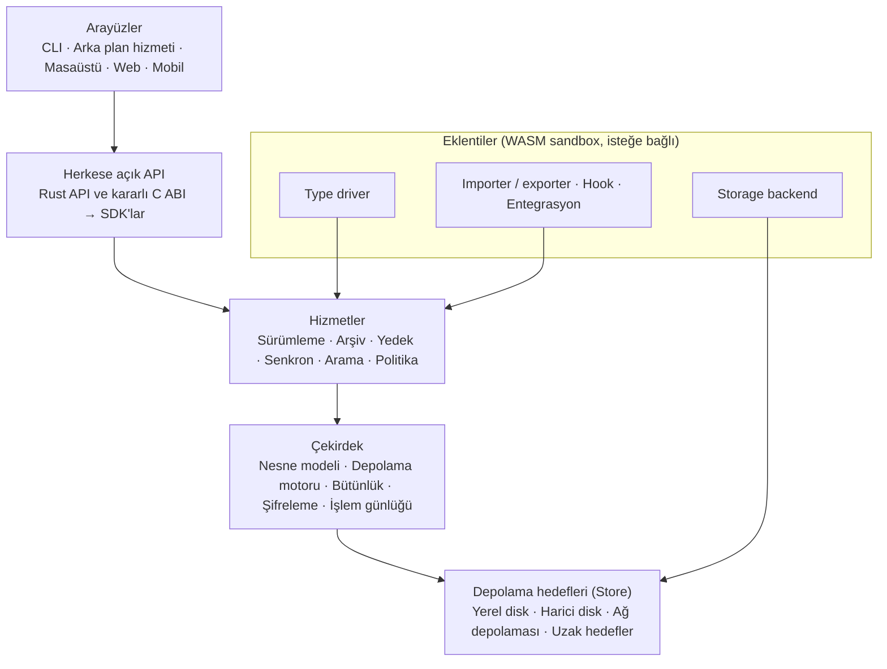

> **English:** [VISION.md](VISION.md)

# Apeiron — Ürün Vizyonu ve Gereksinimler

> **Durum:** Bu belge hedeflenen ürünü anlatır; burada geçen yeteneklerin çoğu henüz yazılmadı (Planlandı). Neyin bittiğini [ROADMAP.tr.md](ROADMAP.tr.md) gösterir.

## Özet

Apeiron; sürüm kontrolü, arşivleme, yedekleme, senkronizasyon ve bütünlük denetimini tek bir çekirdekte birleştiren, genel amaçlı ve çapraz platform bir veri yönetim motorudur. Kaynak kodu desteklenen veri türlerinden yalnızca biridir. Aynı çekirdek bir yazılımcının deposunu, bir müzisyenin projesini ve bir kurumun arşivini yönetir.

Apeiron üç biçimde kullanılır: CLI ve arayüzlerle doğrudan, kütüphane olarak başka uygulamaların içinde ya da arka plan hizmeti olarak uzaktan. Raspberry Pi'dan çok sunuculu kurulumlara kadar ölçeklenir. Hiçbir temel işlev buluta, hesaba veya sürekli internet bağlantısına bağlı değildir.

**Temel tasarım ölçütü:** Yeni bir kullanım alanı eklemek çekirdeği değil, yalnızca eklentileri değiştirmelidir.

## Temel ilkeler

Her tasarım kararı bu on ilkeye göre değerlendirilir. İki ilke çatıştığında, veri güvenliği ve taşınabilirlik kazanır.

1. **Genel amaçlılık:** Git kavramları çekirdeğin değil, bir eklentinin konusudur. Hiçbir veri türü "varsayılan" değildir.
2. **Yerel öncelik:** Tüm temel işlevler çevrimdışı, hesapsız ve bulutsuz çalışır.
3. **Veri sahipliği ve taşınabilirlik:** Depolama formatı açık ve belgelidir. Veri, Apeiron kurulu olmadan da okunabilir ve dışarı aktarılabilir.
4. **Bütünlük:** Her nesne kriptografik özetle doğrulanır. Bozulma hiçbir zaman sessiz kalmaz.
5. **Geri alınabilirlik:** Yıkıcı işlemler varsayılan olarak geri alınabilir. Kalıcı silme ayrı ve açık bir adımdır.
6. **Güvenli varsayılanlar:** Şifreleme, izinler ve denetim kaydı baştan tasarımın parçasıdır, sonradan eklenmez.
7. **İnce çekirdek:** Çekirdek yalnızca veriyi, geçmişi ve politikayı bilir. Alana özgü anlam (ses, metin, kod) eklentilerdedir.
8. **API önceliği:** CLI ve arayüzler, dış geliştiricilerin kullandığı aynı herkese açık API'nin istemcileridir. Gizli iç kapı yoktur.
9. **Kaynak bilinci:** Düşük kaynaklı cihazlar gerçek bir hedeftir, test hedefi değildir.
10. **Kademeli karmaşıklık:** Basit iş uzmanlık gerektirmez. İleri düzey kontrol ise kısıtlanmaz.

## Kullanıcılar ve kullanım alanları

Altı profilin hepsi aynı çekirdeği kullanır. Aralarındaki fark yalnızca son sütundaki eklentilerdedir.

| Profil | Yönetilen veri | Kritik ihtiyaç | Alana özgü işlev (eklenti) |
| --- | --- | --- | --- |
| Yazılımcı ve yazılım ekibi | Kaynak kodu, belgeler, yapılandırma, tasarım dosyaları | Dal, birleştirme, çatışma çözümü, Git uyumu | Git içe/dışa aktarma, satır bazlı diff, kod incelemesi |
| Yazar ve blogcu | Makale, taslak, görsel, kaynak | Sürüm karşılaştırma, kurtarma, yayın onayı | Metin/Markdown diff, statik site üreticisi entegrasyonu |
| Müzisyen ve ses üreticisi | Ses, MIDI, DAW projesi, preset, sample | Büyük dosya verimliliği, proje bütünlüğü | DAW proje ayrıştırma, ses önizleme ve karşılaştırma |
| Sanatçı ve tasarımcı | Görsel, video, tasarım belgesi | Kaynak–çıktı ilişkisi, teslim paketi | Görsel önizleme ve karşılaştırma |
| Ev sunucusu sahibi | Fotoğraf, belge, kişisel arşiv | Otomatik yedek, senkron, silineni geri alma | Fotoğraf metadata, NAS hedefleri |
| Sistem yöneticisi ve kurum | Sunucu yapılandırması, kritik veri | Denetim kaydı, politika, felaket kurtarma | Kimlik sağlayıcı ve izleme entegrasyonu |

## Çekirdek kavramlar ve mimari kararlar

Sürüm kontrolü, yedekleme, arşivleme ve senkronizasyon aynı nesne grafiği üzerinde, farklı politikalarla çalışan işlemlerdir. Bu yüzden dördü için ayrı motor yazılmaz. Bu bölümdeki kararlar sonradan değiştirmesi en pahalı olanlardır ve ilk sürümden önce sabitlenmelidir.

Her katman yalnızca bir altındakini kullanır. Type driver'lar hizmet katmanına, storage backend'ler depolama katmanına bağlanır; çekirdek hiçbir eklentiyi tanımaz.

### Nesne modeli

| Kavram | Ne olduğu | Neden önemli |
| --- | --- | --- |
| Chunk | Dosyanın içerik-tanımlı parçası; özetiyle adreslenir | Tekilleştirme, büyük dosya ve artımlı yedek tek mekanizmayla çözülür |
| Blob | Bir dosyanın chunk listesi | Dosyanın tamamı belleğe alınmadan akışla işlenir |
| Tree | Dizin yapısı ve metadata (izinler, zamanlar, öznitelikler) | Dosya adları ve yapı tam korunur |
| Snapshot | Bir veri kümesinin belirli andaki durumu; ebeveyn snapshot'lara bağlanır | Commit, yedek noktası ve arşiv aynı nesnedir |
| Ref | Bir snapshot'a verilen isim | Dal, etiket ve yedek noktası aynı kavramla temsil edilir |
| Store | Nesnelerin saklandığı yer | Yerel disk, harici disk ve uzak hedef aynı arayüzle kullanılır |
| Policy | Saklama, şifreleme, senkron ve doğrulama kuralları | Davranış veriden ayrı tanımlanır |
| Type driver | Veri türüne özgü diff, birleştirme, önizleme ve indeksleme | Alan bilgisi çekirdeğe girmeden eklenir |

Arşivleme ve yedekleme snapshot kullanır, ama kullanıcı dal, birleştirme gibi hiçbir sürüm kontrol kavramını görmeden bunları kullanabilir.

### Mimari kararlar

1. **Çekirdek dili Rust:** Proje mümkün olan her yerde Rust ile yazılır: derlenir, hızlıdır ve bellek güvenlidir. Dış dünyaya kararlı bir C ABI açılır; diğer dillerin SDK'ları bunun üzerine kurulur.
2. **İçerik adresli, değişmez depolama:** Nesneler bir kez yazılır, hiç değiştirilmez. Her işlem "yaz, diske sabitle, sonra ref'i güncelle" sırasıyla yapılır. Güç kesilirse yarım işlem görünmez.
3. **Açık format spesifikasyonu:** Depolama formatı sürümlü ve belgelidir. Apeiron'dan bağımsız bir okuyucu yazılabilir.
4. **Sandbox'lı eklentiler:** Eklentiler WebAssembly içinde, yalnızca istedikleri izinlerle çalışır. Bir eklenti çökerse çekirdek etkilenmez.
5. **İstemci tarafı şifreleme:** Veri cihazdan şifreli çıkar. Uzak hedef düz metni hiç görmez.
6. **Devam ettirilebilir aktarım protokolü:** Yalnızca karşı tarafta eksik olan chunk'lar gönderilir. Kesilen aktarım kaldığı yerden sürer.

## Temel yetenekler

Bu yeteneklerin hepsi aynı snapshot modelini kullanır; birbirlerinin yan özelliği değildir. Her biri tek başına, diğerlerini kurmadan kullanılabilir.

### Sürümleme ve geçmiş

- Herhangi bir veri kümesinin anlık durumunu kaydetme, geçmişte gezinme, isimli sürüm ve etiket oluşturma.
- Dal açma, birleştirme, rebase ve seçili değişiklikleri taşıma (cherry-pick).
- Dosya düzeyinde karşılaştırma her türde; anlamsal karşılaştırma ve birleştirme, type driver olan türlerde.
- Çatışmaları tespit etme ve çözüm aracı sunma. Eş zamanlı değişiklikte sessiz veri kaybı olmaz.
- Değişikliğin kim tarafından, ne zaman ve neden yapıldığını kaydetme.

### Arşivleme

- Bir veri kümesini veya belirli bir sürümü tek, taşınabilir pakete dönüştürme.
- Paketin içeriğini açmadan inceleme ve içinden seçerek çıkarma.
- İsteğe bağlı sıkıştırma, şifreleme ve parçalara bölme.
- tar ve zip gibi yaygın formatlara dışa aktarma; arşiv Apeiron olmadan da açılabilir.
- Uzun süreli saklamada periyodik doğrulama.

### Yedekleme ve kurtarma

- Elle, zamanlanmış ve değişiklik tetiklemeli yedek; yalnızca değişen chunk'lar aktarılır.
- Yerel disk, harici disk, ağ depolaması ve uzak hedeflere birden fazla bağımsız kopya.
- Saklama politikaları (ör. 7 günlük, 4 haftalık, 12 aylık) ve eski yedeklerin güvenli temizliği.
- Dosya, klasör, proje veya tüm çalışma alanı düzeyinde, belirli bir zamana geri yükleme.
- **Geri yükleme testi:** Yedeğin gerçekten geri yüklenebildiğini düzenli olarak, ayrı bir alanda doğrulama.
- Değiştirilemez (append-only) hedefler ile fidye yazılımına karşı koruma.

### Senkronizasyon

- Tek yönlü ve çift yönlü senkron; yerel ağ, uzak bağlantı ve uygun yerlerde eşler arası.
- Çevrimdışı çalışma; bağlantı gelince değişikliklerin aktarılması.
- Seçmeli senkron, dışlama kuralları, bant genişliği sınırı.
- **Önizleme:** Senkronun neyi değiştireceğini uygulamadan önce gösterme.
- **Yayılma koruması:** Senkron yedek değildir. Silinen veya bozulan dosya her yere yayılsa bile her cihazdaki geçmiş ve yedekler bağımsız kalır.

### Veri bütünlüğü

- Her okuma ve yazmada özet doğrulaması; zamanlanmış tam doğrulama (scrub).
- Bozuk nesneyi başka bir doğrulanmış kopyadan otomatik onarma.
- Kopyalar arası tutarlılık kontrolü.
- Kritik işlemin başarıyla bittiğinin açıkça raporlanması; belirsiz "muhtemelen oldu" durumu yoktur.

### Arama ve organizasyon

- Ad, metadata, etiket ve desteklenen formatlarda tam metin arama.
- Kaydedilebilir sorgular, yinelenen dosya tespiti, bir dosyanın geçmişte nerede kullanıldığını görme.
- İndeks çevrimdışı çalışır, gerektiğinde yeniden oluşturulur; erişim izni olmayan sonuç gösterilmez.

### Paylaşım ve iş birliği

- Kullanıcı ve ekip bazlı paylaşım, süreli veya kısıtlı erişim, erişimi geri alma.
- İnceleme, onay ve yayın akışları; yorum ve notlar. Bunlar yalnızca koda değil, her veri türüne uygulanır.

## Güvenlik, gizlilik ve erişim kontrolü

Güvenlik her kullanım alanında aynı kurallarla çalışır ve ilk sürümden itibaren vardır.

- **Şifreleme:** Saklanan veride ve aktarımda. Anahtarlar kullanıcıdadır; kurtarma anahtarı ayrı ve açıkça yönetilir.
- **Kimlik ve izin:** Kullanıcı ve servis kimlikleri. Okuma, yazma, silme, paylaşma ve yönetme izinleri ayrıdır; alan, proje veya veri kümesi düzeyinde verilir.
- **Denetim kaydı:** Hassas işlemler ve yönetici müdahaleleri kaydedilir. Hassas veri loglara yazılmaz.
- **Eklenti izinleri:** Her eklenti yalnızca bildirdiği izinlerle çalışır.
- **Uzak erişim:** Güvenli varsayılanlarla kapalı gelir; açıkça yapılandırılır.
- **Kurumsal kimlik:** Merkezi kimlik sağlayıcı ve çok faktörlü doğrulama entegrasyonu (ileri aşama).
- **Gizlilik:** Veri hiçbir koşulda zorunlu olarak üçüncü tarafa gönderilmez. Telemetri varsayılan olarak kapalıdır.

## Arayüzler, API ve SDK

Tüm arayüzler aynı herkese açık API'nin istemcisidir. Bir işlem CLI'da yapılabiliyorsa API'de de yapılabilir; bunun tersi de geçerlidir.

### Arayüzler

| Arayüz | Kim için | Temel işlevler | Aşama |
| --- | --- | --- | --- |
| CLI | İleri kullanıcı, sunucu, betik | Tüm işlemler; makine tarafından okunabilir çıktı (JSON), ilerleme, iptal | 1 |
| Arka plan hizmeti (daemon) | Sunucu, zamanlanmış işler | Zamanlanmış yedek ve senkron, uzak API | 2 |
| Masaüstü | Teknik bilgisi sınırlı kullanıcı | Geçmiş, karşılaştırma, geri yükleme, çatışma çözümü, durum izleme | 4 |
| Web | Sunucu yöneticisi, kurum | Uzaktan yönetim, kullanıcı ve izin, raporlama | 4 |
| Mobil | Bireysel kullanıcı | Durum kontrolü, seçili dosya senkronu, kurtarma başlatma | 5+ |

### API gereksinimleri

- Sürümleme, arşiv, yedek, senkron ve yönetim işlemlerinin tamamına erişim.
- Uzun işlemlerde ilerleme bildirimi, iptal ve sonuç sorgulama.
- Büyük veride akış tabanlı arayüz; içerik belleğe alınmaz.
- Tipli, belgelenmiş hata türleri.
- Yerel (gömülü kütüphane) ve uzak (hizmet) kullanım için aynı işlem modeli.
- Semantik sürümleme ve yazılı geriye dönük uyumluluk politikası.

### SDK'lar

Tek kaynak Rust çekirdeği ve onun C ABI'sidir. Diğer SDK'lar bu katmanı sarar, kendi mantığını yeniden yazmaz. Böylece aynı işlem her dilde aynı sonucu verir.

- **İlk dalga:** Rust (yerel), C (ABI), Python, C++.
- **Sonraki dalga:** Go, C#, Java/Kotlin, Swift, JavaScript/TypeScript, Zig.
- Her SDK dilin alışkanlıklarına uyar; iptal, zaman aşımı ve ilerleme bildirimini destekler; örnek uygulamalarla gelir.
- Ortak test paketi: Aynı senaryolar tüm SDK'larda çalıştırılır ve sonuçları karşılaştırılır.

## Eklenti sistemi

Eklentiler isteğe bağlıdır; hiçbiri kurulu olmadan da çekirdek tam çalışır.

| Eklenti türü | Ne sağlar | Örnek |
| --- | --- | --- |
| Type driver | Veri türüne özgü diff, birleştirme, önizleme, indeksleme | Markdown diff, WAV dalga formu karşılaştırması |
| Storage backend | Yeni depolama hedefi | SFTP, S3 uyumlu, WebDAV |
| Importer / exporter | Başka sistemlerden içe ve dışa aktarma | Git deposu, tar/zip |
| Hook / iş akışı | Olaylara bağlı otomasyon | Snapshot sonrası statik siteyi yayınlama |
| Entegrasyon | Harici uygulama bağlantısı | Blog platformu, izleme sistemi |

**Kurallar:**

- Her eklenti izinlerini bildirir; kullanıcı onaylamadan o izinler verilmez.
- Eklenti API'si ayrı sürümlenir; uyumsuz eklenti yüklenmez, çekirdeği bozmaz.
- Çöken veya zaman aşımına uğrayan eklenti izole edilir; işlem güvenli biçimde geri alınır.

## Platformlar ve performans hedefleri

Referans cihaz Raspberry Pi 4'tür (4 GB RAM). Bu cihazda hedefleri karşılayan bir sürüm, daha güçlü donanımda da karşılar. Aşağıdaki sayılar ilk öneridir; Aşama 1 ölçümleriyle güncellenecektir.

**Platformlar:** Linux (x86_64, aarch64) birinci sınıf hedef. Windows ve macOS tam desteklenir. Raspberry Pi, NAS ve ev sunucuları gerçek kullanım hedefidir.

| Senaryo | Hedef (Raspberry Pi 4) |
| --- | --- |
| 100 bin dosyalık çalışma alanında durum sorgusu (status) | 2 sn altı |
| Değişiklik olmayan 100 bin dosyada artımlı yedek | 10 sn altı |
| 10 GB'lık tek dosya ekleme sırasında bellek kullanımı | 256 MB altı, dosya boyutundan bağımsız |
| Boşta bekleyen arka plan hizmeti bellek kullanımı | 50 MB altı |
| Kesilen aktarımda yeniden gönderilen veri | En fazla 1 chunk |

- Arka plan işleri (doğrulama, indeksleme) CPU, disk ve ağ sınırlarıyla çalışır; kullanıcı işlemini yavaşlatmaz.
- Büyük kurulumlar için kapasite birden fazla makineye yayılabilir (ileri aşama).

## Birlikte çalışabilirlik ve veri taşınabilirliği

Kullanıcı Apeiron'dan istediği an, verisini ve geçmişini kaybetmeden çıkabilmelidir. Bu bir kolaylık değil, temel gereksinimdir.

- **İçe aktarma:** Mevcut dosya ve klasörler, yaygın arşiv formatları, Git depoları (geçmişiyle birlikte).
- **Dışa aktarma:** Düz dosyalar, tar/zip, Git deposu; geçmiş ve metadata belgelenmiş bir formatta.
- **Kurulumlar arası taşıma:** Bir Apeiron deposu başka bir kuruluma kayıpsız taşınır.
- **Sürüm geçişi:** Format değişikliklerinde otomatik ve geri alınabilir yükseltme; eski format okunmaya devam eder.
- **Bağımsızlık:** Hiçbir işlev tescilli bir bulut hizmetinin varlığına bağlı değildir.

## Yol haritası

Pahalı kararlar (format, nesne modeli, API ve eklenti sınırı) Aşama 0'da verilir; geri kalan her şey bu temelin üstüne eklenir. Her aşama kendi başına kullanılabilir bir ürün bırakır.

| Aşama | Kapsam | Çıkış kriteri |
| --- | --- | --- |
| 0. Format ve çekirdek | Nesne modeli ve format spesifikasyonu, depolama motoru, bütünlük doğrulama, Rust API taslağı | Spesifikasyon yazılı; güç kesintisi testlerinde veri kaybı yok |
| 1. Yerel MVP | CLI; snapshot alma, geçmiş, dosya düzeyi diff, geri yükleme, doğrulama; yerel ve harici disk yedek hedefi; tar/zip dışa aktarma | Kendi verini bir ay boyunca yalnızca Apeiron ile yedekleyip geri yükleyebilmek |
| 2. Uzak ve senkron | Arka plan hizmeti, zamanlanmış yedek, şifreleme, SFTP ve S3 hedefleri, tek/çift yönlü senkron, çatışma tespiti, geri yükleme testi | İki cihaz ve bir uzak sunucu arasında bir ay sorunsuz senkron |
| 3. Geliştirici ve ekosistem | Dal ve birleştirme, Git içe/dışa aktarma (hedef: Git ağ protokolü), C ABI ve Python SDK, WebAssembly eklenti sistemi, metin diff eklentisi, arama | Gerçek bir Git deposu Apeiron'a taşınıp geri alınabiliyor |
| 4. Arayüzler ve çok kullanıcı | Masaüstü ve web arayüzü, kullanıcı ve izinler, denetim kaydı, paylaşım | Teknik olmayan bir kullanıcı CLI'sız yedek alıp geri yükleyebiliyor |
| 5. Kurumsal | Merkezi kimlik, çok kiracılı kullanım, replikasyon, yüksek erişilebilirlik, değiştirilemez arşiv, uyumluluk raporları | İlk kurumsal pilot kurulum |

## Kapsam dışı ve kaçınılacak hatalar

Kapsam geniş olduğu için neyin yapılmayacağı da açıkça yazılıdır.

- Apeiron'u Git'in yeniden yazılmış hâline dönüştürmek veya her veriyi kaynak kodu gibi ele almak.
- Arşivleme ve yedeklemeyi sürüm kontrolünün yan özelliği yapmak.
- Senkronu yedek yerine saymak.
- Temel işlevleri bir bulut hesabına bağlamak veya veriyi kapalı bir formata hapsetmek.
- Alana özgü işlevleri çekirdeğe ekleyip sistemi şişirmek.
- Dillere göre farklı davranan SDK'lar yazmak; API'yi yalnızca kendi arayüzlerinin kullanabileceği kadar dar tutmak.
- Güvenliği ve yetkilendirmeyi sonraki sürümlere bırakmak.
- Kurumsal özellikler için temel veri güvenilirliğinden ödün vermek.
- Kısa vadeli kolaylık için, ileride büyük mimari değişiklik gerektirecek kararlar almak.

## Başarı ölçütleri

Başarı özellik sayısıyla değil, aşağıdaki sorulara test edilebilir bir "evet" verilmesiyle ölçülür.

1. **Genellik:** Aynı çekirdek en az üç farklı veri türünde (kod, metin, medya) çekirdek değişmeden kullanılıyor mu?
2. **Güvenilirlik:** Güç kesintisi, disk dolması ve ağ kopması testlerinde sıfır veri kaybı var mı?
3. **Kurtarma:** Her yedek, otomatik geri yükleme testinden geçiyor mu?
4. **Ölçek:** Performans hedefleri Raspberry Pi 4'te karşılanıyor mu; aynı sürüm çok sunuculu kurulumda çalışıyor mu?
5. **Ekosistem:** En az bir dış uygulama, kendi arayüzünü yalnızca herkese açık API ile kurabiliyor mu?
6. **Genişletilebilirlik:** Yeni bir veri türü desteği, çekirdeğe dokunmadan eklenti olarak eklenebiliyor mu?
7. **Taşınabilirlik:** Bir depo, geçmişiyle birlikte Apeiron dışına kayıpsız aktarılabiliyor mu?

## Alınan kararlar

Aşama 0 bu kararlarla başlar. Dil ve Git uyumu proje sahibinin kararıdır; diğerleri bu ikisine uyacak şekilde seçildi.

| Konu | Karar | Gerekçe |
| --- | --- | --- |
| Dil | Mümkün olan her yerde Rust; C yalnızca dışa açılan ABI katmanında | Derlenir, hızlıdır, bellek güvenlidir |
| Git uyumu | İçe/dışa aktarma zorunlu; Git ağ protokolü (SSH ve smart HTTP) hedef ama şart değil | gitoxide (gix) saf Rust bir Git uygulaması; protokol sıfırdan yazılmaz |
| Özet algoritması | BLAKE3 | Paralel ve çok hızlı; Raspberry Pi'da da verimli; resmi Rust kütüphanesi var |
| Chunk bölme | FastCDC, ortalama 1 MiB chunk (ayarlanabilir) | Küçük bir değişiklikte yalnızca etkilenen chunk'lar yeniden yazılır |
| Eklenti ortamı | WebAssembly bileşen modeli, Wasmtime çalışma zamanı | Sandbox ve izin modeli hazır gelir; Wasmtime Rust ile yazılmıştır; eklentiler her dilde yazılabilir |
| Asenkron çalışma zamanı | Tokio | Ağ, senkron ve arka plan hizmeti için Rust'taki fiili standart |
| İlk hedef kullanıcı | Kişisel yedek ve ev sunucusu | En dar gerçek kullanım; Aşama 1 çıkış kriteriyle doğrudan ölçülür. Geliştirici özellikleri Aşama 3'te |
| Lisans | MIT veya Apache-2.0 (çift lisans) | Rust ekosisteminin standardı; SDK'nın başka uygulamalara gömülmesini kolaylaştırır |
