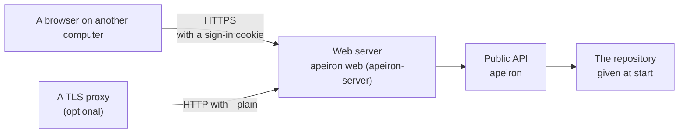

> **Türkçe:** [WEB.tr.md](WEB.tr.md)

# Web Interface

> **Status: Done.** This is the design of Stage 4 work item 2 ([ROADMAP.md](ROADMAP.md) §6): the pages of the desktop interface ([DESKTOP.md](DESKTOP.md)) served to other computers on the network, for a repository on a home server. The decision behind it is ADR-027 ([DECISIONS.md](DECISIONS.md)).

The person who runs the server signs in from a browser on another computer and backs up, looks at and restores folders of the server. Several users with their own rights are work item 3 ([USERS.md](USERS.md)).

## 1. How it is built



| Part | What it is | Status |
| --- | --- | --- |
| Pages | The pages of the desktop interface, with a sign-in screen | Done |
| Web server | `apeiron-server` in web mode: the same JSON API, on an address of the network, over TLS, to a signed-in browser | Done |
| `apeiron web` | Starts the web server for one repository; `apeiron web user` manages who may sign in (USERS.md §3) | Done |

## 2. Starting it

```text
apeiron web user add efe --role admin
apeiron web --repo /srv/backup --listen 0.0.0.0:8443 --folder /home/efe
```

| Option | Meaning | Default |
| --- | --- | --- |
| `--repo` | The repository served; opened at start, with `--password-file` when encrypted | Required |
| `--listen` | Address and port | `0.0.0.0:8443` |
| `--cert`, `--key` | Certificate chain and private key, PEM files | A self-signed certificate |
| `--plain` | Plain HTTP, only behind a proxy that adds TLS | Off |
| `--folder` | A folder of the server that users may be given (USERS.md §1); can be given more than once | The home folder |

Without `--cert` and `--key`, a self-signed certificate for `localhost` and the listen address is made once and kept in the configuration folder (`web-cert.pem`, `web-key.pem`). Its SHA-256 fingerprint is printed at start; the browser warns about it once, and the fingerprint it shows must be the printed one.

The users and the Argon2id hashes of their passwords are kept in `web.json` in the configuration folder (`~/.config/apeiron` on Linux), readable only by its owner (USERS.md §2). Without an `admin` the server does not start.

## 3. What changes from the desktop interface

| Topic | Desktop | Web |
| --- | --- | --- |
| Who may call | The holder of the token in the address | A browser signed in as a user (USERS.md) |
| Address | `127.0.0.1` | Any address given with `--listen` |
| Repository | Any, chosen on the start screen | Only the one given at start; the start screen and Close are not shown |
| Folders | All folders of the user | Only folders inside `--folder` |
| Operations | All of the C ABI | Only those the pages use (§4) |
| Leaving | Close | Sign out |

## 4. The JSON API

The requests of DESKTOP.md §3 stay, with these differences:

| Request | In web mode |
| --- | --- |
| `GET /api/session` | Allowed without signing in: `{"mode": "local" or "web", "signed_in"}` |
| `POST /api/login` `{"name", "password"}` | Signs in; sets the cookie `apeiron_session` |
| `POST /api/logout` | Signs out and forgets the session |
| `POST /api/open`, `POST /api/init` | Refused with `unsupported` |
| `POST /api/call/<operation>` | Only `info`, `resolve`, `log`, `list`, `diff`, `diff_text`, `refs`, `reflog`; others are refused with `unsupported` |
| `POST /api/start/<operation>` | Only `backup`, `restore`, `verify`, `search`; `source` of a backup and `target` of a restore must be inside a `--folder` |
| `GET /api/folders` | Only inside a `--folder`; without a path, the first one; `parent` is empty at a `--folder` |

A request without a valid session has status 401 with the kind `invalid_input` and `"sign_in": true`, and the pages show the sign-in screen.

## 5. Security

| Rule | Why |
| --- | --- |
| TLS 1.2 or 1.3 through `rustls`, unless `--plain` | The password and the backups do not cross the network in clear |
| The session is a random 256-bit value in a cookie with `HttpOnly`, `Secure`, `SameSite=Strict`, `Path=/` | Scripts cannot read it and other sites cannot send it |
| A session ends after 12 hours without a request, after 7 days in any case, at sign-out and when the server stops | A forgotten browser does not stay signed in |
| After 5 wrong passwords in a row, every sign-in is refused for 60 seconds (status 429, kind `locked`) | Guessing the password takes too long; the cost is that someone who guesses can keep the owner out for a while |
| A request with an `Origin` header must have the same host as its `Host` header | Another site cannot call the API |
| Paths are compared after resolving links and `..`; a restore target that does not exist yet is checked through its nearest existing parent | Nobody reaches a folder outside `--folder` by a detour |
| Only the operations of §4 | Remotes, keys, export and plugins, which reach further, stay with the CLI |
| The headers of DESKTOP.md §4 (CSP, `no-store`, `nosniff`) | The same pages, the same rules |

An `admin` can read every backup of the repository and write into the `--folder` folders with the rights of the user that runs the server; other roles reach less (USERS.md §1). The server should therefore run as an ordinary user, never as root.

## 6. Not part of this work item

| Item | Where |
| --- | --- |
| Several users, roles and rights per backup | Work item 3 ([USERS.md](USERS.md)) |
| A record of who did what | Work item 4 ([AUDIT.md](AUDIT.md)) |
| Certificates from Let's Encrypt | Later; a proxy such as Caddy does this today with `--plain` |
| Remotes, sync, keys and plugins in the pages | Later |

## 7. Crates

| Crate | Role | Status |
| --- | --- | --- |
| `apeiron-server` | Web mode next to the local mode | Done |
| `apeiron-cli` | `apeiron web` | Done |
