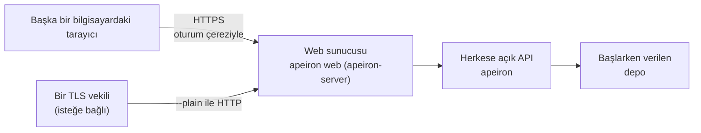

> **English:** [WEB.md](WEB.md)

# Web Arayüzü

> **Durum: Tamamlandı.** Aşama 4'ün 2. işinin tasarımıdır ([ROADMAP.tr.md](ROADMAP.tr.md) §6): masaüstü arayüzünün sayfaları ([DESKTOP.tr.md](DESKTOP.tr.md)), bir ev sunucusundaki depo için ağdaki başka bilgisayarlara sunulur. Arkasındaki karar ADR-027'dir ([DECISIONS.tr.md](DECISIONS.tr.md)).

Sunucuyu çalıştıran kişi, başka bir bilgisayardaki tarayıcıdan oturum açar ve sunucunun klasörlerini yedekler, onlara bakar ve geri yükler. Kendi hakları olan birden çok kullanıcı 3. iştir ([USERS.tr.md](USERS.tr.md)).

## 1. Nasıl kurulur



| Parça | Nedir | Durum |
| --- | --- | --- |
| Sayfalar | Masaüstü arayüzünün sayfaları, bir oturum açma ekranıyla | Tamamlandı |
| Web sunucusu | Web kipindeki `apeiron-server`: aynı JSON API, ağdaki bir adreste, TLS üzerinden, oturum açmış bir tarayıcıya | Tamamlandı |
| `apeiron web` | Web sunucusunu tek bir depo için başlatır; kimin oturum açabileceğini `apeiron web user` yönetir (USERS.tr.md §3) | Tamamlandı |

## 2. Başlatmak

```text
apeiron web user add efe --role admin
apeiron web --repo /srv/backup --listen 0.0.0.0:8443 --folder /home/efe
```

| Seçenek | Anlamı | Varsayılan |
| --- | --- | --- |
| `--repo` | Sunulan depo; başlarken açılır, şifreliyse `--password-file` ile | Zorunlu |
| `--listen` | Adres ve kapı | `0.0.0.0:8443` |
| `--cert`, `--key` | Sertifika zinciri ve özel anahtar, PEM dosyaları | Kendinden imzalı bir sertifika |
| `--plain` | Düz HTTP, yalnızca TLS ekleyen bir vekilin arkasında | Kapalı |
| `--folder` | Sunucunun kullanıcılara verilebilen bir klasörü (USERS.tr.md §1); birden çok kez verilebilir | Ev klasörü |
| `--replicate` | Her yedekten sonra her ref'in push edildiği bir uzak depo ([REPLICATION.tr.md](REPLICATION.tr.md) §4); birden çok kez verilebilir | Yok |
| `--standby` | Bir yedek sunucu kopyası sunar: yedek almak dışında her şey ([REPLICATION.tr.md](REPLICATION.tr.md) §5) | Kapalı |

`--cert` ve `--key` verilmezse, `localhost` ve dinlenen adres için kendinden imzalı bir sertifika bir kez oluşturulur ve yapılandırma klasöründe tutulur (`web-cert.pem`, `web-key.pem` ve oluşturulduğu adlarla `web-cert.names`); yalnızca yeni bir kiracının ana makinesi gibi yeni bir ad gerektiğinde yeniden oluşturulur ([TENANTS.tr.md](TENANTS.tr.md) §3). SHA-256 parmak izi başlarken yazılır; tarayıcı bir kez uyarır ve gösterdiği parmak izi yazılanla aynı olmalıdır.

Kullanıcılar ve parolalarının Argon2id özetleri, yapılandırma klasöründeki (Linux'ta `~/.config/apeiron`) `web.json` dosyasında, yalnızca sahibinin okuyabileceği biçimde tutulur (USERS.tr.md §2). Bir `admin` yoksa sunucu başlamaz.

## 3. Masaüstü arayüzünden farkları

| Konu | Masaüstü | Web |
| --- | --- | --- |
| Kim çağırabilir | Adresteki jetona sahip olan | Bir kullanıcı olarak oturum açmış bir tarayıcı (USERS.tr.md) |
| Adres | `127.0.0.1` | `--listen` ile verilen herhangi bir adres |
| Depo | Başlangıç ekranında seçilen herhangi biri | Yalnızca başlarken verilen; başlangıç ekranı ve Kapat gösterilmez |
| Klasörler | Kullanıcının bütün klasörleri | Yalnızca `--folder` içindeki klasörler |
| İşlemler | C ABI'nin hepsi | Yalnızca sayfaların kullandıkları (§4) |
| Çıkmak | Kapat | Oturumu kapat |

## 4. JSON API

DESKTOP.tr.md §3'teki istekler şu farklarla kalır:

| İstek | Web kipinde |
| --- | --- |
| `GET /api/session` | Oturum açmadan izinli: `{"mode": "local" ya da "web", "signed_in"}` |
| `POST /api/login` `{"name", "password"}` | Oturum açar; `apeiron_session` çerezini koyar |
| `POST /api/logout` | Oturumu kapatır ve unutur |
| `GET /api/health` | Oturum açmadan izinli: `{"ok", "role": "primary" ya da "standby"}`; depo okunamıyorsa `503` ([REPLICATION.tr.md](REPLICATION.tr.md) §5) |
| `POST /api/open`, `POST /api/init`, `/api/schedule` | `unsupported` ile reddedilir |
| `POST /api/call/<operation>` | Yalnızca `info`, `resolve`, `log`, `list`, `diff`, `diff_text`, `refs`, `reflog`, bir `admin` için ayrıca `retention`, `add_retention` ([ARCHIVE.tr.md](ARCHIVE.tr.md)); diğerleri `unsupported` ile reddedilir |
| `POST /api/start/<operation>` | Yalnızca `backup`, `restore`, `verify`, `search`, `report` ([REPORTS.tr.md](REPORTS.tr.md)); bir yedeğin `source` alanı ve bir geri yüklemenin `target` alanı bir `--folder` içinde olmalıdır |
| `GET /api/folders` | Yalnızca bir `--folder` içinde; yol verilmezse ilki; bir `--folder` üzerinde `parent` boştur |

Geçerli bir oturumu olmayan istek, `invalid_input` türü ve `"sign_in": true` ile 401 durumunu alır; sayfalar oturum açma ekranını gösterir.

## 5. Güvenlik

| Kural | Neden |
| --- | --- |
| `--plain` yoksa `rustls` üzerinden TLS 1.2 ya da 1.3 | Parola ve yedekler ağdan açık olarak geçmez |
| Oturum, `HttpOnly`, `Secure`, `SameSite=Strict`, `Path=/` taşıyan bir çerezde rastgele 256 bitlik bir değerdir | Betikler onu okuyamaz, başka siteler gönderemez |
| Bir oturum 12 saat istek gelmezse, her durumda 7 gün sonra, oturum kapatılınca ve sunucu durunca biter | Unutulan bir tarayıcı açık kalmaz |
| Art arda 5 yanlış paroladan sonra her oturum açma 60 saniye reddedilir (429 durumu, `locked` türü) | Parolayı tahmin etmek çok uzun sürer; bedeli, tahmin eden birinin sahibini bir süre dışarıda tutabilmesidir |
| `Origin` başlığı olan bir istekte o başlığın sunucusu `Host` başlığıyla aynı olmalıdır | Başka bir site API'yi çağıramaz |
| Yollar bağlantılar ve `..` çözüldükten sonra karşılaştırılır; henüz olmayan bir geri yükleme hedefi en yakın var olan üst klasörüyle denetlenir | Kimse dolambaçlı bir yolla `--folder` dışındaki bir klasöre ulaşamaz |
| Yalnızca §4'teki işlemler | Daha uzağa uzanan uzak hedefler, anahtarlar, dışa aktarma ve eklentiler CLI'da kalır |
| DESKTOP.tr.md §4'teki başlıklar (CSP, `no-store`, `nosniff`) | Aynı sayfalar, aynı kurallar |

Bir `admin` deponun her yedeğini okuyabilir ve sunucuyu çalıştıran kullanıcının haklarıyla `--folder` klasörlerine yazabilir; diğer roller daha azına ulaşır (USERS.tr.md §1). Bu yüzden sunucu root olarak değil, sıradan bir kullanıcı olarak çalıştırılmalıdır.

## 6. Bu işin parçası olmayanlar

| Konu | Nerede |
| --- | --- |
| Birden çok kullanıcı, roller ve yedek başına haklar | 3. iş ([USERS.tr.md](USERS.tr.md)) |
| Kimin ne yaptığının kaydı | 4. iş ([AUDIT.tr.md](AUDIT.tr.md)) |
| Let's Encrypt sertifikaları | Sonra; bugün Caddy gibi bir vekil bunu `--plain` ile yapar |
| Sayfalarda uzak hedefler, senkron, anahtarlar ve eklentiler | Sonra |

## 7. Crate'ler

| Crate | Görevi | Durum |
| --- | --- | --- |
| `apeiron-server` | Yerel kipin yanında web kipi | Tamamlandı |
| `apeiron-cli` | `apeiron web` | Tamamlandı |
